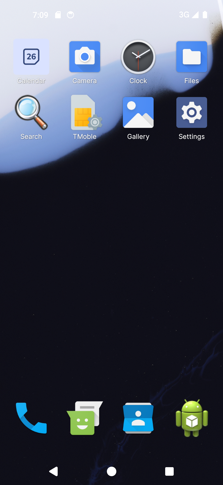
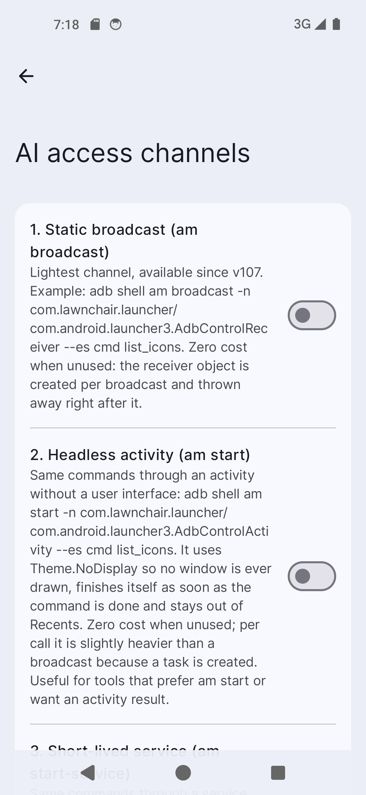
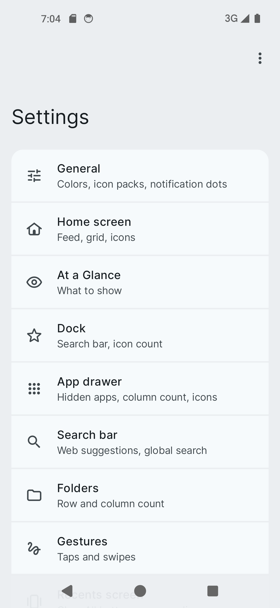
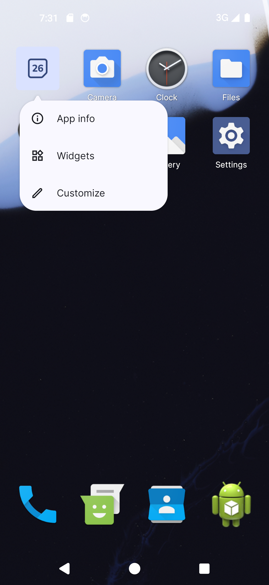
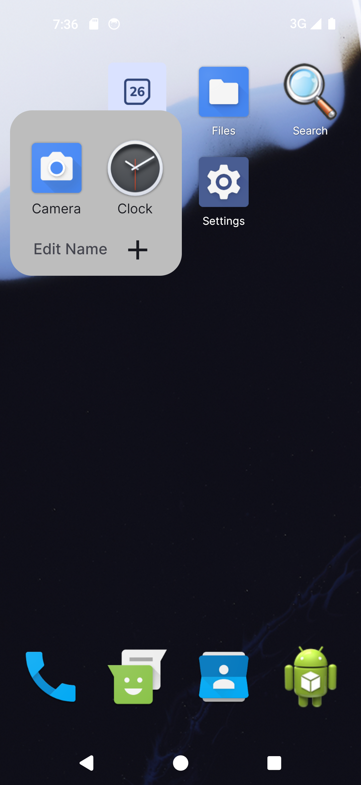
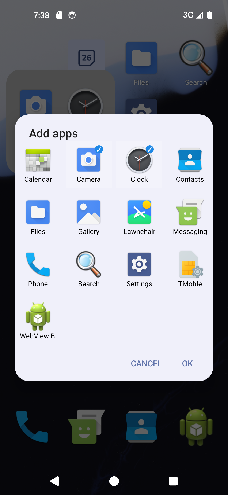
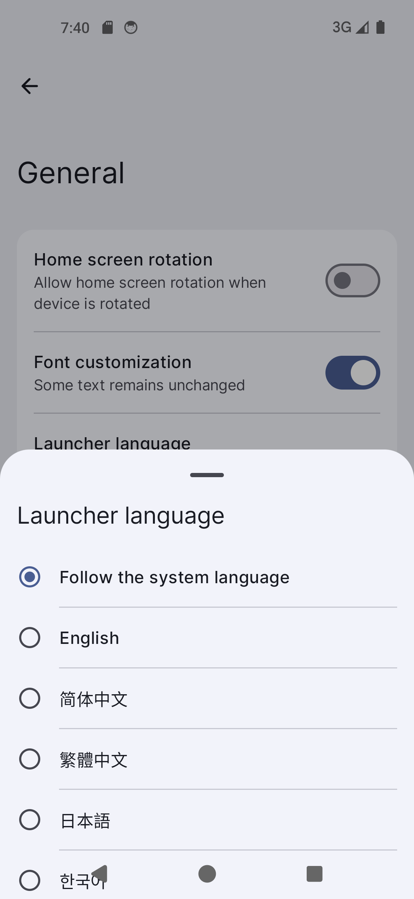

# Lawnchair 15 — AI Control Fork

> 📖 **AI control channels manual / AI 通道使用手册** — full per-channel instructions and call
> examples: **[English →](docs/AI_CONTROL.md)** • **[中文 →](docs/AI_CONTROL.zh-CN.md)**
>
> 🤝 **How to wire an AI up / 如何接入 AI** — system prompt, MCP client configs (Claude Desktop,
> Python, TypeScript), REST, a ready-made Skill and scripts: **[English →](docs/AI_INTEGRATION.md)**
> • **[中文 →](docs/AI_INTEGRATION.zh-CN.md)**

A personal fork of [Lawnchair 15](https://github.com/LawnchairLauncher/lawnchair) (beta 3) that turns the
home screen into something an **AI agent or a script can drive**, and layers a set of practical
launcher tweaks on top. It stays a normal, installable Android home app — the extra powers are all
opt-in switches.

## What this fork adds

### 🤖 AI Control Interface

Nine independent, individually-toggleable entry points let an external agent or `adb` read and
reshape the workspace:

| Channel | Entry point | Enable switch |
|---------|-------------|---------------|
| Broadcast | `AdbControlReceiver` | `pref_enable_adb_control` |
| Activity | `AdbControlActivity` | `pref_enable_adb_activity` |
| Service | `AdbControlService` | `pref_enable_adb_service` |
| ContentProvider | `AdbControlProvider` | `pref_enable_adb_provider` |
| Deep Link | `launcher://control?cmd=…` | `pref_enable_adb_link` |
| Batch | `bulkInsert` on the provider | `pref_enable_adb_batch` |
| HTTP REST | `localhost:9091` (loopback only) | `pref_enable_adb_http` |
| MCP | JSON-RPC over `POST /mcp` on the same loopback server | `pref_enable_adb_mcp` |
| Shortcut | dynamic launcher shortcuts | `pref_enable_adb_shortcut` |

Commands: `list_icons`, `move_icon`, `add_icon`, `remove_icon`, `reload`. The HTTP server
exposes `GET /help`, `/list`, `/state`, `/cmd` and `POST /mcp`. Every channel is **off by default**
and gated behind its own switch under **Settings → AI control**.

Full per-channel instructions and call examples (adb, deep link, HTTP, MCP, batch, shortcuts) are
in the manual: **[English](docs/AI_CONTROL.md)** • **[中文](docs/AI_CONTROL.zh-CN.md)**.

### Other changes on top of upstream

- **No-drawer home (toggle):** flatten every app onto the workspace instead of an app drawer; the
  classic drawer can be re-enabled with a single switch. A per-app "hidden from home" list is
  included.
- **Classic drag mode:** no spring-loaded zoom / top bar; page by hovering near the left/right edge
  with a configurable trigger range (5%–30%, default 15%).
- **Icon long-press menu:** customize which rows show and their order, plus a **Force Stop** entry.
- **Folder upgrades:** an "add apps" editor (global de-duplication / return-to-desktop), a tight-fit
  grid that avoids stray empty cells, and a default folder tint.
- **In-app language switching** across 23 languages.
- Log collection/export, reset settings to defaults, custom icon import, wallpaper blur, and several
  experimental features promoted to stable.

## Screenshots

Real captures from the `lawnWithQuickstepGithubDebug` build running on an Android 14 (API 34) device.

| Home screen (no-drawer) | AI access channels |
|:--:|:--:|
|  |  |

**Home screen (no-drawer).** With the no-drawer toggle on, every app is flattened directly onto the
workspace instead of an app drawer — here eight apps sit in a tidy 4×2 grid, with the dock below.
There is no drawer to swipe up; the classic drawer can be re-enabled with a single switch.

**AI access channels.** *Settings → General → AI access channels* exposes one independent switch per
control channel (broadcast, activity, service, provider, deep link, batch, HTTP, MCP, shortcut), each
with a short description and a runnable example. Every channel is off by default. See
[docs/AI_CONTROL.md](docs/AI_CONTROL.md) • [中文](docs/AI_CONTROL.zh-CN.md) for the full manual.

**How to wire an AI up.** No special software is needed in the model — give it a short **system prompt**
that lists the tools, or connect it over **MCP** so it auto-discovers them. The integration guide
[docs/AI_INTEGRATION.md](docs/AI_INTEGRATION.md) • [中文](docs/AI_INTEGRATION.zh-CN.md) has a copy-paste
prompt, MCP client configs (Claude Desktop, Python and TypeScript SDKs) and REST usage; a ready-made
Skill ships at [`skills/launcher-control/SKILL.md`](skills/launcher-control/SKILL.md).

| Settings overview |
|:--:|
|  |

**Settings.** The launcher's settings entry points — General (where AI access channels and in-app
language live), Home screen, Dock, App drawer, Search bar, Folders, Gestures, and more.

### Workspace & customization

| Icon long-press menu | Folder open | Add apps to folder | In-app language |
|:--:|:--:|:--:|:--:|
|  |  |  |  |

**Icon long-press menu.** Long-pressing a workspace icon shows a compact popup (App info, Widgets,
Customize); which rows appear and in what order is configurable.

**Folder.** Tapping a folder expands it in place, with *Edit Name* and a **＋** button. The folder grid
is tight-fit so it avoids stray empty cells.

**Add apps.** The **＋** opens an app picker where you tick which apps belong in the folder (already
included apps are pre-checked), with global de-duplication / return-to-desktop behaviour.

**In-app language.** *Settings → General → Launcher language* switches the launcher UI language on the
spot across 23 languages, independent of the system language.

## Building

Open the project in Android Studio and select the **`lawnWithQuickstepGithubDebug`** build variant.
The `@hide` Android APIs the launcher compiles against are supplied by the checked-in
`prebuilts/libs/*.jar`, so no AOSP tree is required.

## Upstream

This branch is based on the official **Lawnchair 15.0.0-beta3.0** tag. Lawnchair itself is a free,
open-source home app for Android that starts from Launcher3 and ports Pixel Launcher features while
adding rich customization. All credit for the base project goes to the
[Lawnchair team](https://lawnchair.app); see their [main repository](https://github.com/LawnchairLauncher/lawnchair)
for the original project, releases, and contribution channels.

- Compare against upstream: `v15.0.0-beta3.0...lawnchair-enhancements`
- Upstream community: [Telegram](https://t.me/lccommunity) • [Discord](https://discord.gg/3x8qNWxgGZ)
